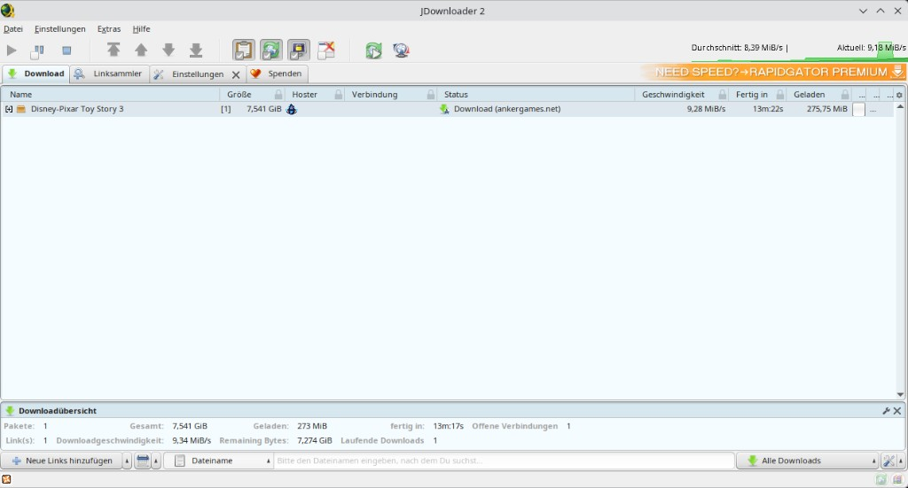

<p align="center">
  
</p>

<h1 align="center">AnkerGames → JDownloader&nbsp;2</h1>

<p align="center">
  AnkerGames-Downloads, die in JDownloader laufen<br/>
  Manuelle Installation · Kein MyJD · Kein AnkerGames-Login<br/>
  Companion: nur Chromium (Chrome, Vivaldi, Brave, Edge) — kein Firefox
</p>

<p align="center">
  <a href="https://github.com/benjarogit/jd2plugin-ankergames-download/releases/latest/download/ankergames-jd2-full.zip"></a>
  &nbsp;
  <a href="https://jdownloader.org/jdownloader2"></a>
</p>

<p align="center">
  
  
  · <a href="README.md">English</a>
</p>

<p align="center">
  
</p>

---

[ankergames.net](https://ankergames.net) steckt hinter Cloudflare. Der Java-Client von JD wird blockiert.  
Dieses Paket liefert **JD-Plugin** + **Browser-Companion**: Turnstile im echten Browser, Datei per localhost an JD.

**Browser aktuell: nur Chromium** (Chrome, Vivaldi, Brave, Edge). Firefox gibt es nicht.

> Inoffiziell — nicht verbunden mit AppWork, JDownloader oder AnkerGames.

---

### Installation

| Schritt | Aktion |
|:-------:|--------|
| 0 | Kein JD? → [JDownloader 2 herunterladen](https://jdownloader.org/jdownloader2) |
| 1 | [Dieses ZIP laden](https://github.com/benjarogit/jd2plugin-ankergames-download/releases/latest/download/ankergames-jd2-full.zip) und entpacken |
| 2 | JD-Ordner finden → Plugin-Dateien kopieren → `Core.jar` patchen |
| 3 | Chromium-Companion laden |
| 4 | Spiel-URL in JD → Captcha lösen → JD lädt |

In JDownloader denselben Chromium-Browser für Captchas einstellen, in dem der Companion installiert ist (Chrome / Vivaldi / Brave / Edge).

<details>
<summary><b>JD-Ordner finden</b></summary>

<br/>

Bei jedem PC anders (Installer vs Portable). Du brauchst den Ordner mit **`JDownloader.jar`**.

| Name | Bedeutung | Beispiel |
|------|-----------|----------|
| **JD-Root** | `JDownloader.jar` + `Core.jar` | `C:\JDownloader\` · `~/.jd/` |
| **Plugin-Ordner** | Unterordner `jd/plugins/` | `…/jd/plugins/` |

**Pathfinder (aus dem ZIP):**

| OS | Ausführen |
|----|-----------|
| Windows | `plugin/find-jd-home.bat` doppelklicken |
| Linux / macOS | `cd plugin && chmod +x find-jd-home.sh && ./find-jd-home.sh` |

<details>
<summary>Selbst suchen</summary>

1. Nach `JDownloader.jar` suchen (`Win+S`)  
2. Rechtsklick → Dateipfad öffnen → JD-Root  
3. `jd` → `plugins` öffnen → Plugin-Ordner  

</details>

<details>
<summary>Nichts gefunden</summary>

1. JDownloader einmal starten  
2. Rechtsklick auf Verknüpfung → Dateipfad öffnen  
3. Portable: Desktop / Downloads / USB / anderes Laufwerk  
4. Oder nach `Core.jar` suchen (neben `JDownloader.jar`)  
5. Plugins nach `<JD-Root>/jd/plugins/` kopieren  

</details>

</details>

<details>
<summary><b>Plugin + Core-Patch installieren</b></summary>

<br/>

1. JDownloader komplett beenden  
2. In deinen Plugin-Ordner kopieren:

| Aus dem ZIP | Ziel |
|-------------|------|
| `plugin/plugins/hoster/*` | `<JD-Root>/jd/plugins/hoster/` |
| `plugin/plugins/decrypter/*` | `<JD-Root>/jd/plugins/decrypter/` |
| `plugin/plugins/components/*` | `<JD-Root>/jd/plugins/components/` |

Fertig bei `<JD-Root>/jd/plugins/hoster/AnkergamesNet.class`.

3. **`Core.jar`** im JD-Root (neben `JDownloader.jar`) mit 7-Zip patchen — zuerst Backup:

| In `Core.jar` | Ersetzen durch |
|---------------|----------------|
| `…/cloudflareturnstile/turnstile.html` | `core-patch/turnstile.html` |
| `…/cloudflareturnstile/CloudflareTurnstileChallenge.class` | `core-patch/CloudflareTurnstileChallenge.class` |

4. JDownloader starten  

</details>

<details>
<summary><b>Browser-Companion (Chromium)</b></summary>

<br/>

1. `chrome://extensions` öffnen (oder `vivaldi://extensions` / `brave://extensions` / `edge://extensions`)  
2. **Entwicklermodus** einschalten  
3. **Entpackte Erweiterung laden** → Ordner `companion/chromium/` wählen (nicht die ZIP-Wurzel)  
4. Prüfen: **JD Turnstile Companion** steht in der Liste (Version **1.0.0**)  

Nach Updates: Erweiterungsseite öffnen → Companion neu laden.

</details>

<details>
<summary><b>Benutzung</b></summary>

<br/>

1. In JD z. B. `https://ankergames.net/game/…` einfügen  
2. Download starten → Turnstile im Browser lösen (oft automatisch)  
3. Der Companion streamt die CDN-Datei nach JD; der AnkerGames-Tab schließt sich selbst  

```text
Turnstile → Companion holt CDN → localhost-Relay → JD speichert
```

</details>

<details>
<summary><b>Probleme</b></summary>

<br/>

| Problem | Lösung |
|---------|--------|
| Pathfinder leer | Siehe „Nichts gefunden“ oben |
| Plugin fehlt in JD | Dateien unter `…/jd/plugins/…` + Core-Patch |
| Companion fehlt | Entpackt laden → Ordner `companion/chromium/` |
| Browser-Speichern-Dialog | Abbrechen · Companion **1.0.0** neu laden |
| Pipe failed / 0 B | Companion neu laden · bei Brave Shields auf ankergames.net kurz runter |

</details>
